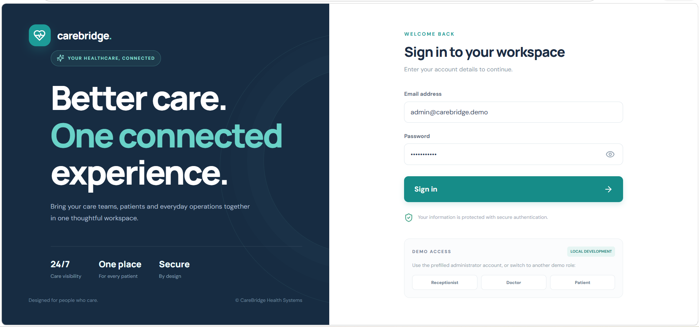
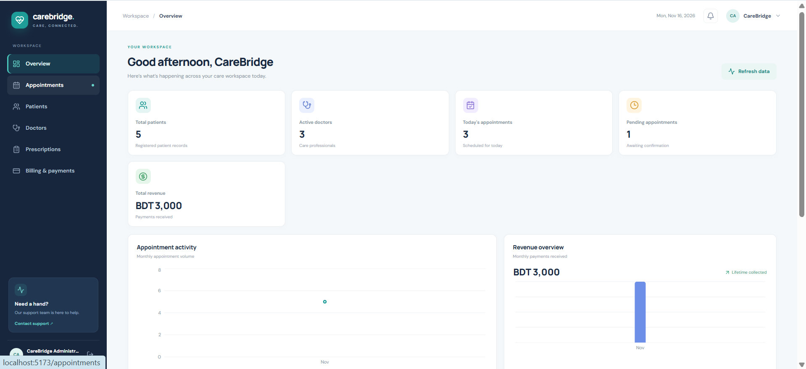
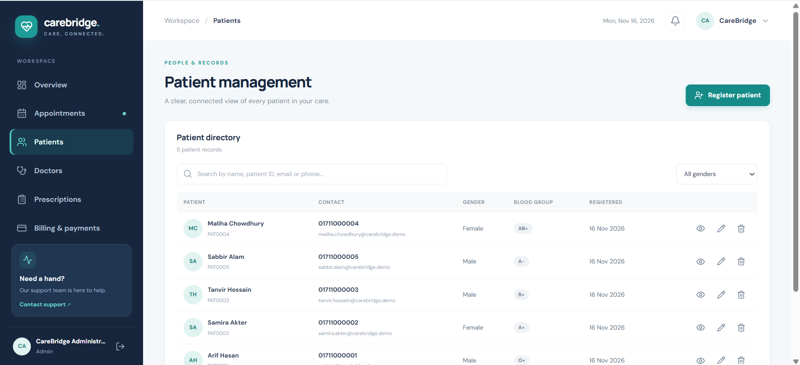
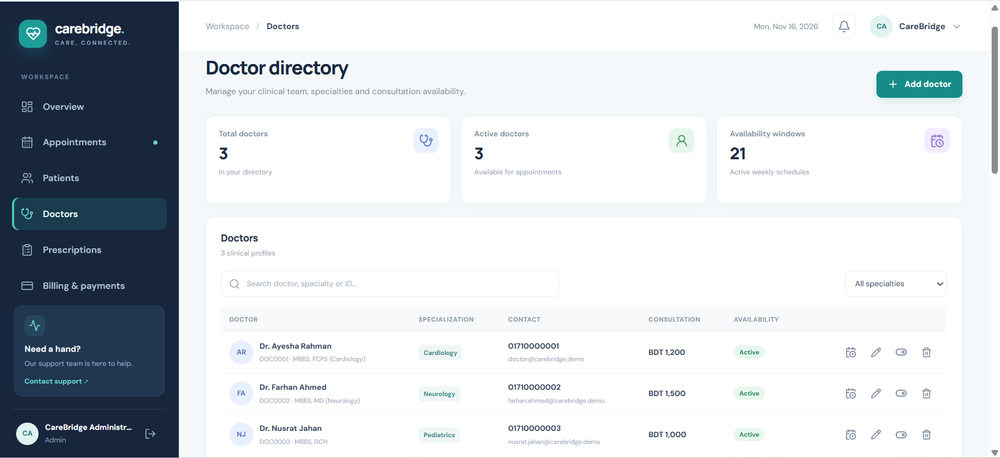
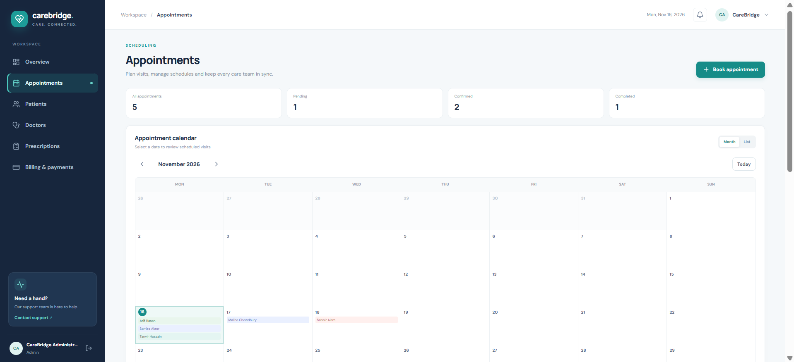
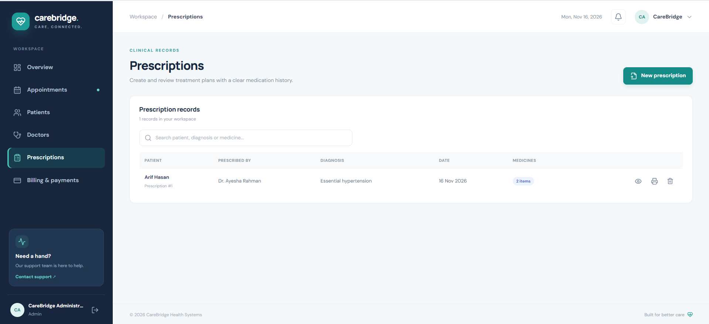
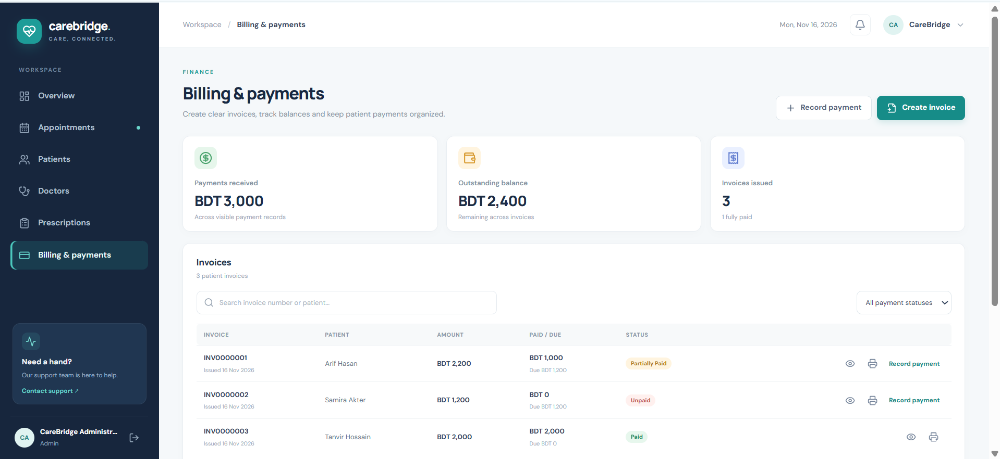
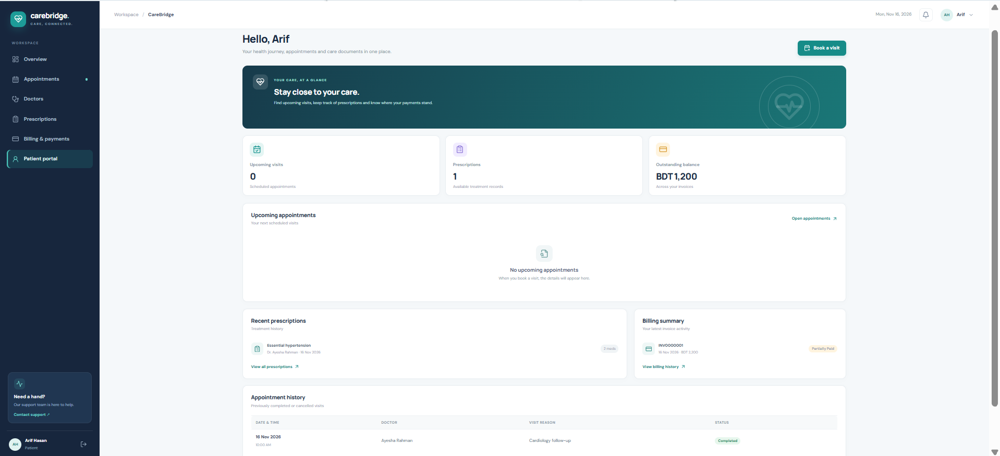

# CareBridge – Hospital & Clinic Management System

A full-stack hospital and clinic operations platform built with **Django REST Framework** and **React**. CareBridge brings patient records, doctor profiles, appointment scheduling, prescriptions, invoices and payments into one role-aware workspace.

> **Portfolio / local-demo project:** use fictional seed data only. This project is not a certified clinical system and must not be used to store real patient data.

## Current delivery status

- **Phase 1 – Architecture:** completed.
- **Phase 2 – Django backend:** source code, six Django apps, initial migrations, REST APIs, role-aware permissions, demo seeding and automated backend tests prepared.
- **Phase 3 – React frontend:** source code, Vite configuration, role-aware screens, API client, portals, forms, charts and frontend checks prepared.
- **Phase 4 – Integration review:** API route/serializer alignment reviewed; identified frontend runtime defects and scheduling issues fixed; source-level checks passed. Full Django/Vite runtime verification remains pending local dependency installation.
- **Phase 5 – Demo data verification:** seeding command audited and hardened for repeatability; demo-account, relationship, schedule, appointment-status, prescription, invoice and payment-state tests added. Runtime test execution remains pending local dependency installation.
- **Phase 6 – Real screenshots:** the Playwright capture script is included. Seven real application screenshots supplied by the developer after running CareBridge locally have now been added and verified; the Patient Portal screenshot remains outstanding. See [Phase 6 screenshot report](docs/PHASE6_SCREENSHOT_REPORT.md) and [Phase 7 screenshot report](docs/PHASE7_SCREENSHOT_EMBEDDING_REPORT.md).
- **Phase 7 – Screenshot README embedding:** seven of the eight requested images are embedded below using relative Markdown links. The Patient Portal screenshot was captured by the developer but could not be uploaded due to the current attachment limit; it is not included in this ZIP and is not fabricated.
- **Phase 8 – Final GitHub release package:** prepared and packaged with seven verified, real screenshots. The Patient Portal screenshot can be added later without rebuilding the application; the README contains a clearly labeled pending section and a helper script to insert the real image.

## Product modules

- **Dashboard:** role-aware metrics, recent appointments, monthly appointment activity and revenue charts.
- **Patients:** patient directory, search/filter, registration, editing, record details, appointment history, prescription history and billing history.
- **Doctors:** doctor profiles, specialties, fees, active status and recurring weekly availability windows.
- **Appointments:** booking from configured doctor availability, time-slot generation, calendar view, status management, cancellation and history.
- **Prescriptions:** nested medicine lines, diagnosis, instructions, patient/doctor history and print view.
- **Billing:** invoices, consultation and service charges, discounts, server-calculated totals, payment history, balances and print view.
- **Patient portal:** personal appointments, prescriptions, invoices, payment status and doctor directory access.
- **Doctor portal:** doctor schedule, assigned patients, appointment history and prescription workflow.

## Technology

| Layer | Technologies |
|---|---|
| Backend | Python 3.11, Django 5.2, Django REST Framework |
| Authentication | Simple JWT, custom email-based user model, role-based permissions |
| Database | SQLite |
| API support | django-cors-headers, django-filter, DRF pagination and schema endpoint |
| Frontend | React 18, Vite, JavaScript, Tailwind CSS 3 |
| UI & data | Axios, React Router, Recharts, Lucide React, date-fns |
| Frontend checks | Vitest, Testing Library |

## Project structure

```text
CareBridge/
├── backend/
│   ├── config/
│   ├── accounts/
│   ├── patients/
│   ├── doctors/
│   ├── appointments/
│   ├── prescriptions/
│   ├── billing/
│   ├── requirements.txt
│   └── manage.py
├── frontend/
│   ├── src/
│   │   ├── components/
│   │   ├── context/
│   │   ├── layouts/
│   │   ├── pages/
│   │   ├── services/
│   │   ├── test/
│   │   └── utils/
│   ├── package.json
│   └── vite.config.js
├── docs/
│   ├── screenshots/
│   │   ├── login.png
│   │   ├── dashboard.png
│   │   ├── patients.png
│   │   ├── doctors.png
│   │   ├── appointments.png
│   │   ├── prescriptions.png
│   │   ├── billing.png
│   │   └── patient-portal.png (add the real capture later)
│   ├── PHASE4_INTEGRATION_REPORT.md
│   ├── PHASE5_DEMO_DATA_REPORT.md
│   ├── PHASE6_SCREENSHOT_REPORT.md
│   └── PHASE7_SCREENSHOT_EMBEDDING_REPORT.md
├── scripts/
│   ├── capture_screenshots.py
│   ├── finalize_patient_portal_screenshot.py
│   ├── requirements-screenshots.txt
│   ├── verify_release.py
│   └── verify_source_contract.py
├── tests/
├── README.md
└── .gitignore
```

## Database architecture

The backend defines a custom `accounts.User` model and related patient/doctor profiles. Appointments connect patients and doctors; prescriptions connect patient, doctor and optional appointment with nested medicine lines; invoices connect patients and optional appointments with invoice items and payment transactions.

Important rules include sequential patient IDs (`PAT0001`...), unique emails where applicable, appointment availability and overlap validation, database constraints on appointment start times and invoice total calculations on the server. For high-concurrency production scheduling, PostgreSQL and stronger database-level time-range constraints are recommended.

## Windows 11 installation

### Prerequisites

- Python 3.11
- Node.js 20 LTS or later and npm
- Git (optional, for GitHub publishing)
- PyCharm (recommended) or VS Code

Extract the ZIP, then open the `CareBridge` folder in PyCharm.

### 1. Backend setup

Open **Terminal 1** in the project root:

```bat
cd backend
py -3.11 -m venv venv
venv\Scripts\activate
python -m pip install --upgrade pip
pip install -r requirements.txt
python manage.py migrate
python manage.py seed_demo
python manage.py runserver
```

Backend: [http://127.0.0.1:8000/](http://127.0.0.1:8000/)  
Health check: [http://127.0.0.1:8000/api/health/](http://127.0.0.1:8000/api/health/)  
API schema: [http://127.0.0.1:8000/api/schema/](http://127.0.0.1:8000/api/schema/)

### 2. Frontend setup

Keep Terminal 1 running. Open **Terminal 2** in the project root:

```bat
cd frontend
copy .env.example .env
npm install
npm run dev
```

Frontend: [http://localhost:5173/](http://localhost:5173/)

The frontend defaults to `http://127.0.0.1:8000/api`. Set `VITE_API_BASE_URL` in `frontend/.env` to override it. Both backend and frontend must remain running in separate terminals.

### 3. Capture real application screenshots (after both servers are running)

Open a third terminal at the project root:

```bat
py -3.11 -m pip install -r scripts\requirements-screenshots.txt
py -3.11 -m playwright install chromium
py -3.11 scripts\capture_screenshots.py
```

The automation writes the eight PNG files under `docs/screenshots/` and verifies their dimensions. See [docs/PHASE6_SCREENSHOT_REPORT.md](docs/PHASE6_SCREENSHOT_REPORT.md) for troubleshooting and environment-variable overrides.

## Demo login credentials

After running `python manage.py seed_demo`, use these fictional local demo accounts. The command updates the four known demo accounts to these roles and passwords on every run, so their documented credentials remain usable in a local demo:

| Role | Email | Password |
|---|---|---|
| Admin | `admin@carebridge.demo` | `Admin@12345` |
| Receptionist | `reception@carebridge.demo` | `Reception@12345` |
| Doctor | `doctor@carebridge.demo` | `Doctor@12345` |
| Patient | `patient@carebridge.demo` | `Patient@12345` |

These credentials are intentionally public demo credentials. Change them before any non-local use. Never use sample accounts or seed records for real patient data.

## API documentation

All API resources are under `/api/`. The root API documentation is in [backend/README.md](backend/README.md). The frontend integration mapping is in [frontend/README.md](frontend/README.md).

| Resource | Endpoint |
|---|---|
| Token obtain / refresh | `/api/auth/token/` · `/api/auth/token/refresh/` |
| Current user | `/api/auth/me/` |
| Dashboard summary | `/api/dashboard/summary/` |
| Patients | `/api/patients/` |
| Doctors | `/api/doctors/` |
| Doctor availability | `/api/availabilities/` |
| Appointments | `/api/appointments/` |
| Prescriptions | `/api/prescriptions/` |
| Invoices | `/api/invoices/` |
| Payments | `/api/payments/` |

## Role permissions

- **Admin:** full access to all modules.
- **Receptionist:** patient and doctor records, appointments, invoices and payments; prescription records are read-only.
- **Doctor:** assigned patients, own appointments and availability, create/update own prescriptions, and read relevant billing records. Doctors can complete their own appointments.
- **Patient:** own profile, appointments, prescriptions, invoices and payments; browse active doctors and book/cancel own appointments.

Backend querysets and permission checks are authoritative. Frontend route guards improve navigation but do not replace server-side authorization.

## Demo seed data and repeatability

Run `python manage.py seed_demo` as often as needed. The command is transactional and repeatable: it updates the known demo users and linked profiles, reuses the same five demo appointments when the calendar date changes, reconciles doctor availability windows and prescription medicines, and refreshes the three demo invoices and their payment examples. It does not delete unrelated users, appointments or invoices. The sample data includes all four appointment statuses and unpaid, partially paid and paid invoices. All names, contact details, clinical notes and payments are fictional.

Expected clean-database seed summary:

| Record type | Expected count |
|---|---:|
| Demo accounts | 4 |
| Doctors | 3 |
| Patients | 5 |
| Appointments | 5 |
| Doctor availability windows | 21 |
| Prescriptions / medicines | 1 / 2 |
| Invoices / invoice items | 3 / 3 |
| Payments | 2 |

Existing non-demo rows are not included in those counts. The database may therefore contain additional records after you begin using the application.

## Testing and quality checks

Backend:

```bat
cd backend
venv\Scripts\activate
python manage.py test
```

Frontend:

```bat
cd frontend
npm test
npm run build
```

The frontend includes 7 Vitest cases for display formatting and appointment-slot generation. The backend contains 26 Django test cases covering authentication/JWT refresh, role permissions, profile synchronization, patient/doctor creation, booking/rescheduling conflicts, prescriptions, invoice calculations, payment status and demo seed creation/idempotency/relationships.

**Verification note:** The developer subsequently confirmed that the Django API health endpoint returned `{"application":"CareBridge API","status":"ok"}`, successfully signed in through the React frontend, and supplied genuine local screenshots for the login, admin dashboard, patients, doctors, appointments, prescriptions and billing pages. This is user-confirmed local smoke evidence, not a substitute for the complete automated suite. The 26 Django test cases are included but were not run in the build workspace because Django/DRF were unavailable there. The Vite production build and 7 Vitest checks were also not run in the build workspace because `node_modules` was unavailable. Full automated API/browser end-to-end test results are therefore not claimed. Run the backend tests, frontend tests and production build on the Windows development PC before treating this as a fully verified production release. See the [Phase 4 integration report](docs/PHASE4_INTEGRATION_REPORT.md) and [Phase 5 demo-data report](docs/PHASE5_DEMO_DATA_REPORT.md).

## Application screenshots

The following screenshots were supplied from the developer's locally running CareBridge application. They are real UI captures, not generated mockups. The original PNGs are included in this repository under `docs/screenshots/` and are embedded here with relative paths so they render on GitHub.

### 1. Login page



### 2. Admin dashboard



### 3. Patient management



### 4. Doctor management



### 5. Appointment management and calendar



### 6. Prescription management



### 7. Billing and payments



## Patient Portal Screenshot



This is the real Patient Portal screenshot from the running application.

## Publish to GitHub

1. Create a new empty repository on GitHub (do not initialize it with a README, license or `.gitignore`). A suggested repository name is `CareBridge-Hospital-Clinic-Management-System`.
2. Open PowerShell in the extracted `CareBridge` project root. Confirm that no real database, `.env` file, media upload or patient information is being committed. The included `.gitignore` excludes local databases, secrets, virtual environments and frontend build output while retaining the PNG screenshots.
3. Run the following commands, replacing the remote URL if you choose another repository name:

```powershell
git init
git add .
git status
git commit -m "Initial CareBridge hospital management system release"
git branch -M main
git remote add origin https://github.com/matiur-rahman1/CareBridge-Hospital-Clinic-Management-System.git
git push -u origin main
```

If Git says the remote already exists, inspect it with `git remote -v` and update it with `git remote set-url origin <your-repository-url>`. Once the Patient Portal PNG is added later, run `python scripts/finalize_patient_portal_screenshot.py`, verify with `python scripts/verify_release.py`, then commit and push that image and README update.

**Before publishing:** the demo passwords in this README are intentionally public; never reuse them outside a local demo. Do not publish real patient data, `.env` secrets, or a populated SQLite database.

## Future improvements

- Add a richer drag-and-drop scheduling calendar and configurable clinic holidays.
- Add email/SMS appointment reminders and configurable notification preferences.
- Add audit logs, consent tracking, and stronger production security controls.
- Move to PostgreSQL for production concurrency and backups.
- Add deployment automation, containerization, observability and CI workflows.

## Developer

**MD Matiur Rahman**  
BEng in Computer Science and Technology  
Nantong University, China  
GitHub: [matiur-rahman1](https://github.com/matiur-rahman1)
